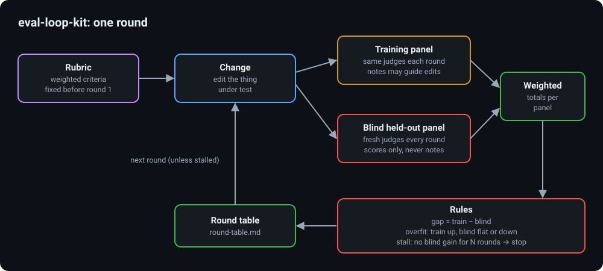

# eval-loop-kit

A small kit for self-improvement loops with blind held-out evaluation. Each round, one change is scored
by a training panel and by a fresh blind panel with the same weighted rubric. The kit computes weighted
totals, the train-minus-blind gap, flags overfitting, applies a stall rule, and writes a round table.
Python standard library only.

Used on: my voice assistant's loop, where the blind pass rate rose from 47.7% to 77.3% (first vs latest
round, each round on a fresh set of 44 asks), and the review loop for my portfolio site.

Author: Kamal Mehta · [kamal-mehta.com](https://kamal-mehta.com/?r=github)



## Why

When the same judges both guide the edits and grade the result, scores rise because the edits learn those
judges, not because the work improves. A held-out panel that never guides an edit shows the difference.
Making it fresh every round (new judges, never seen before) stops it from being learned slowly over many
rounds. The kit turns that into three numbers per round and two rules:

- **Gap** = training score − blind score. A growing gap means the edits fit the training panel.
- **Overfitting**: training rose by at least `gain` while the blind score moved less than `noise`.
- **Stall**: the blind score has not beaten its best by more than `noise` for N rounds. Stop, and keep the
  best blind round, not the last one.

The judges can be people or models; the kit only reads their scores. The example data is invented.

## How it works



1. Write the rubric (`RUBRIC_TEMPLATE.md`, saved as JSON like `examples/rubric.json`): criteria with
   weights that sum to 1 and anchors a judge can check.
2. Each round, record one change and both panels' scores in a rounds file (`examples/rounds.json`):

   ```
   {"rounds": [{"round": 0, "change": "baseline",
                "train": [{"judge": "T1", "scores": {"clarity": 72, ...}}, ...],
                "blind": [{"judge": "B0-1", "scores": {...}}, ...]}, ...]}
   ```

3. Run the kit. `evalloop/core.py` checks that every blind judge is new (never on an earlier blind panel,
   never on the training panel), computes each judge's weighted total, averages each panel, and applies
   the rules.

## How to run

Needs Python 3.9 or newer. No packages to install.

```
python -m unittest discover -s tests
python -m evalloop examples/rubric.json examples/rounds.json --stall 3 --noise 1 --gain 1 --out round-table.md
python scripts/pii_scan.py
```

## Results example (invented data)

| Round | Change | Train | Blind | Gap | Δ train | Δ blind | Flags |
|---|---|---|---|---|---|---|---|
| 0 | baseline | 70.1 | 68.1 | 2.0 |  |  |  |
| 1 | lead with the outcome | 74.1 | 72.1 | 2.0 | +4.0 | +4.0 |  |
| 2 | one idea per sentence | 78.1 | 75.1 | 3.0 | +4.0 | +3.0 |  |
| 3 | add terms the training judges asked for | 80.1 | 75.1 | 5.0 | +2.0 | +0.0 | overfit |
| 4 | more of the same terms | 82.1 | 74.1 | 8.0 | +2.0 | -1.0 | overfit |
| 5 | revert round 4, keep round 3 order | 81.1 | 77.1 | 4.0 | -1.0 | +3.0 |  |
| 6 | shorter closing line | 81.1 | 77.1 | 4.0 | +0.0 | +0.0 |  |
| 7 | swap example order | 81.1 | 76.1 | 5.0 | +0.0 | -1.0 |  |
| 8 | reword the opening | 82.1 | 77.1 | 5.0 | +1.0 | +1.0 | stall: no blind gain for 3 rounds, stop |

```
best blind: round 5 (77.1); overfit rounds: [3, 4]; stall stop: round 8
```

Reading it: rounds 3 and 4 raised the training score by adding what the training judges asked for, while
the blind panel stayed flat and then fell; the gap grew from 3.0 to 8.0. Reverting in round 5 brought the
blind score to its best. Rounds 6 to 8 did not beat it by more than the noise band, so the loop stops, and
the round 5 version is the one to keep.

## Choosing the numbers

- `noise`: score one unchanged item with two different blind panels; their difference is the noise.
  Changes smaller than that are not evidence.
- `gain`: usually the same as `noise`.
- `--stall`: 2 to 3 rounds for cheap judges, more when each round is costly to undo.

## License

MIT License. Copyright (c) 2026 Kamal Mehta. See [LICENSE](LICENSE).
